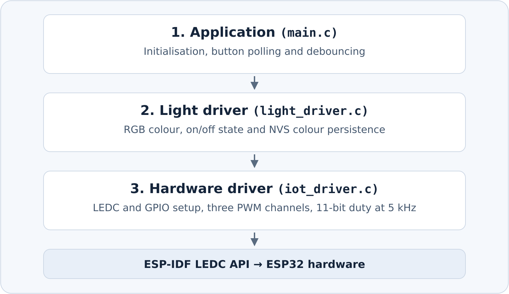

# ESP32 RGB Light Driver

An ESP-IDF project for an ESP32-WROOM development board, a common-cathode RGB LED, and a push button. The driver controls each colour channel independently with LEDC PWM, toggles the light from a debounced GPIO input, and restores the last saved colour after a restart.

## Hardware

- ESP32-WROOM development board (AZ-Delivery ESP-32 NodeMCU)
- Common-cathode RGB LED and three 330 Ω resistors
- Normally open momentary push button, breadboard, jumper wires, and USB data cable

Disconnect USB while wiring. Check the LED pinout for your specific part.

| Signal | ESP32 connection | Wiring |
| --- | --- | --- |
| Red | GPIO21 | Red anode through its own 330 Ω resistor |
| Green | GPIO19 | Green anode through its own 330 Ω resistor |
| Blue | GPIO18 | Blue anode through its own 330 Ω resistor |
| LED common cathode | GND | Direct connection |
| Push button | GPIO23 and GND | Connect across the normally open contacts |

The button uses the ESP32's internal pull-up. GPIO23 reads high when released and low when pressed. If you use a four-leg switch, pick two legs that have continuity only when pressed.

## Build and flash

Use ESP-IDF 5.1. From the project directory, with the ESP-IDF environment loaded, run:

```bash
idf.py set-target esp32  # First-time setup for a fresh checkout
idf.py build
idf.py -p /dev/ttyUSB0 flash monitor
```

Replace `/dev/ttyUSB0` with your board's serial port if needed. Press **Ctrl+]** to exit the serial monitor.

## How it works



The application reads the button, the light driver manages the RGB colour and on/off state, and the hardware driver applies PWM through LEDC.

| Public function | Behaviour |
| --- | --- |
| `light_driver_init(&config)` | Configures the PWM hardware and loads a saved colour from NVS when one exists. The fallback colour is purple `(255, 0, 128)`. |
| `light_driver_update_rgb(red, green, blue)` | Saves the selected colour to NVS, updates the in-memory colour, and applies it immediately if the light is on. |
| `light_driver_set_switch(on)` | Turns the light on with the selected colour or turns it off. |

## Hardware checks

- **RGB channels.** Try `(255, 0, 0)`, `(0, 255, 0)`, and `(0, 0, 255)` with the light on. Verify that each tuple lights the expected channel.
- **Button.** With the polling loop running, press and hold the button. The LED should toggle once. Release it and press again to toggle back to the same colour.
- **Default and persistence.** Enable the startup colour test in `main.c`, with a five-second delay followed by `light_driver_update_rgb(255, 0, 0)`. On the first startup with empty NVS, the LED should show purple for five seconds, then red. Disable the startup RGB update, reflash while preserving NVS, and turn on the LED. Its first lit colour should be red. Use the **EN/RST** button to repeat the restore test.

To start the default-colour test with empty NVS, stop the serial monitor and erase the NVS partition. This clears all settings in that partition.

```bash
python "$IDF_PATH/components/partition_table/parttool.py" \
  --port /dev/ttyUSB0 erase_partition --partition-name=nvs
```
